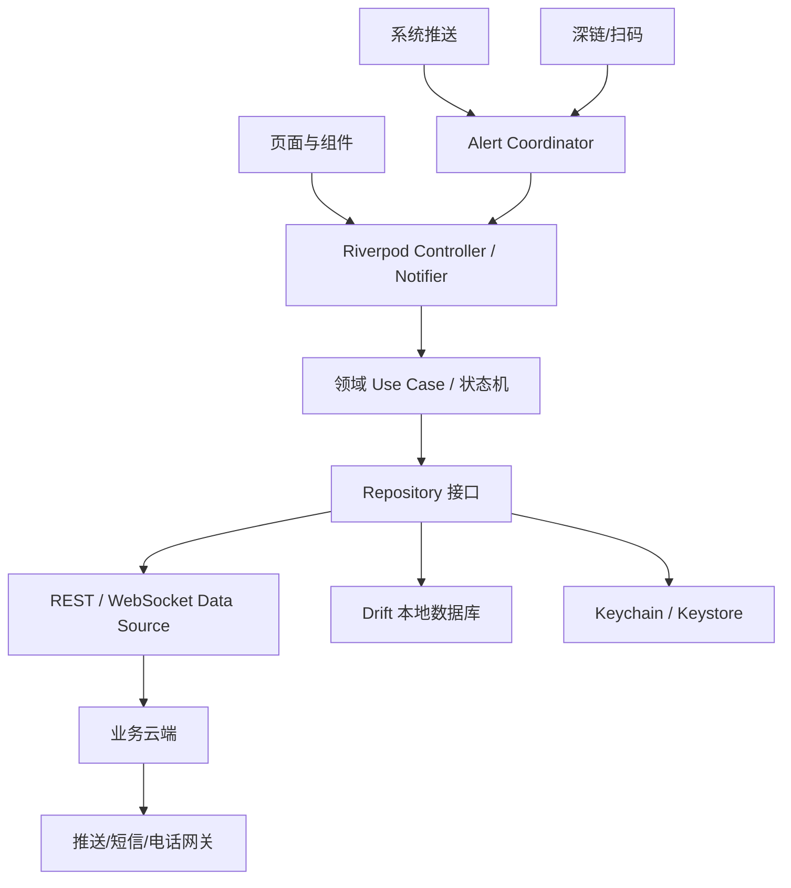
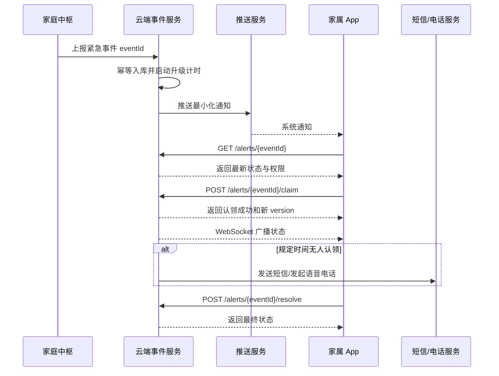
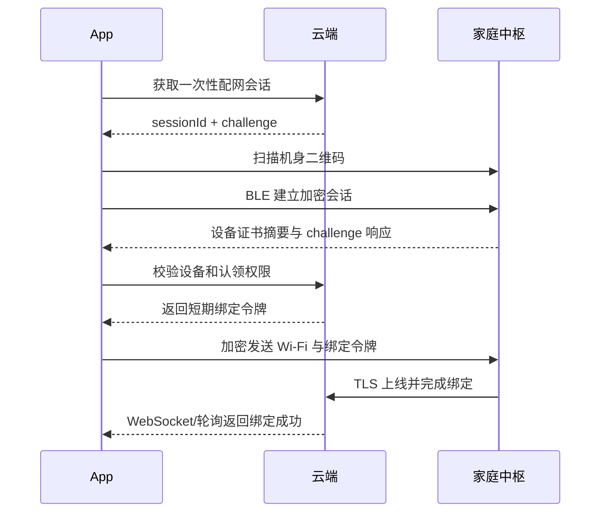
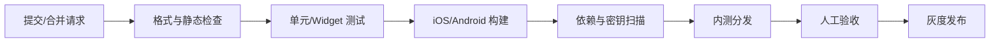

# VeniCare 类产品 App 端技术详细设计

> 文档版本：V1.0  
> 编制日期：2026-10-26  
> 适用阶段：技术验证、MVP 与首批家庭试点  
> 目标市场假设：中国大陆  
> 客户端范围：家属端 iOS/Android App

## 1. 文档目的

本文档给出家属端 App 的功能边界、技术选型、客户端架构、接口协议、数据模型、告警处理、安全策略、测试方案和实施计划。

App 的首要目标不是展示尽可能多的传感器数据，而是可靠回答以下问题：

1. 老人当前是否存在待处理风险；
2. 哪位联系人正在处理；
3. 家庭中枢和关键传感器是否正常工作；
4. 今日用药等照护计划是否按预期执行；
5. 在弱网、重复通知和多人同时操作时，事件状态是否一致。

## 2. 设计范围

### 2.1 一期功能

- 手机号验证码注册和登录；
- 家庭创建、加入及成员管理；
- 老人档案和照护关系；
- 家庭中枢扫码、蓝牙配网及绑定；
- 老人状态总览；
- 疑似跌倒和主动求助告警；
- 告警接收、认领、取消认领及完成处置；
- 事件时间线和处置记录；
- 用药计划管理和确认记录；
- 设备在线、故障和低电量状态；
- 联系人顺序与告警升级策略；
- 通知设置和手机权限检查；
- 数据授权、隐私设置和账号注销；
- App 日志、崩溃诊断和版本升级提示。

### 2.2 二期功能

- 饮水趋势；
- 多老人管理；
- 护理机构账号和交接班；
- 家庭成员聊天或事件留言；
- 穿戴设备接入；
- 服务订阅和付费；
- 可配置照护日报、周报；
- 微信小程序轻量查看。

### 2.3 非目标

- App 不直接运行跌倒检测算法；
- App 不直接连接雷达或读取雷达原始点云；
- App 不作为紧急事件唯一通知渠道；
- App 不提供诊断、处方或用药建议；
- 一期不在后台保持 MQTT 长连接；
- 一期不开发一套同时兼容 App 和微信小程序的跨端 UI。

## 3. 技术选型摘要

| 领域 | 选择 | 主要理由 |
| --- | --- | --- |
| 跨平台框架 | Flutter + Dart | 一套代码覆盖 iOS/Android，UI 一致，插件和原生扩展能力较成熟 |
| 工程架构 | Feature-first + 分层架构 | 业务模块内聚，便于并行开发，避免过度 Clean Architecture |
| 状态管理/依赖注入 | Riverpod | 编译期友好、易测试、不依赖 BuildContext、适合异步状态 |
| 路由 | go_router | 官方生态主流方案，支持守卫、深链和嵌套路由 |
| 网络 | Dio | 拦截器、取消、上传下载、重试接入方便 |
| 数据模型 | Freezed + json_serializable | 不可变模型、联合类型、JSON 代码生成，减少手写错误 |
| 本地数据库 | Drift + SQLite/SQLCipher | 查询明确、迁移可控、适合事件和离线任务 |
| 凭据存储 | flutter_secure_storage | 使用 iOS Keychain 和 Android Keystore |
| 实时通信 | WebSocket | 前台低延迟刷新，服务端和移动端实现成熟 |
| 后台通知 | 个推 UniPush + 厂商通道 + APNs | 覆盖国内 Android 厂商通道，减少逐家接入成本 |
| 紧急兜底 | 服务端短信/语音电话 | 移动推送无法保证必达，必须使用独立通道 |
| 蓝牙配网 | flutter_blue_plus + 自定义安全协议 | Flutter 可统一调用 BLE，必要时可下沉原生 |
| 扫码 | mobile_scanner | 性能和跨平台维护成本较合适 |
| 监控 | 自建 Sentry + OpenTelemetry | 支持崩溃定位和链路关联，并可控制数据存储位置 |
| CI/CD | GitHub Actions/GitLab CI + Fastlane | 自动测试、签名、构建及分发流程成熟 |

依赖版本不在本文写死。项目启动时选择各组件最新稳定版，写入 lockfile，并通过依赖升级 PR 逐步更新，禁止流水线自动跨大版本升级。

## 4. 关键技术选型与理由

### 4.1 Flutter

选择 Flutter 开发 iOS 和 Android 家属端。

采用理由：

- 家属端以状态卡片、事件时间线、表单和告警交互为主，适合跨平台统一实现；
- 同一团队可以维护两端，MVP 成本低于两套原生应用；
- 渲染一致，适合大字号、高对比度等适老化视觉要求；
- BLE、推送、Keychain/Keystore、扫码和生物识别均可通过插件或 Platform Channel 接入；
- 当紧急告警、后台任务等能力需要原生适配时，可以保留 Swift/Kotlin 扩展。

未选择 React Native 的原因：

- 两者均可完成需求，但团队尚无既定前端技术约束时，Flutter 的 UI 一致性和类型体系更适合本项目；
- 本项目不是以 Web 代码复用为优先目标。

未选择 uni-app 的原因：

- uni-app 更适合需要快速复用微信小程序的业务；
- 本项目涉及 BLE、安全存储、复杂推送、后台行为和原生权限，原生能力与长期可控性优先于小程序复用。

未选择纯原生的原因：

- Swift 和 Kotlin 双团队在 MVP 阶段成本较高；
- 当前不存在必须全量使用原生实现的图形、音视频或系统级能力。

边界：若后续发现特定厂商推送、BLE 配网或 iOS 告警体验无法由插件可靠实现，该模块使用原生代码，不更换整体框架。

### 4.2 Riverpod

选择 Riverpod 同时承担状态管理和依赖注入。

采用理由：

- Provider 不依赖 Widget 上下文，业务逻辑可在纯 Dart 测试；
- 对 Future、Stream 和异步状态有直接支持；
- 可按家庭、老人或事件参数创建独立状态；
- 依赖关系显式，便于替换 Repository 和 Mock；
- 比全局 Service Locator 更容易追踪状态来源。

不采用大型 Redux/BLoC 全局事件总线。紧急事件流程使用明确的领域状态机，而普通页面状态使用 Riverpod，避免所有交互都被包装成事件造成样板代码膨胀。

### 4.3 Feature-first 分层架构

采用“按业务模块组织，模块内部再分层”的结构：

```text
lib/
  app/
    app.dart
    bootstrap.dart
    router.dart
    theme/
    localization/
  core/
    auth/
    database/
    error/
    logging/
    network/
    notification/
    security/
    websocket/
  features/
    authentication/
      data/
      domain/
      presentation/
    families/
      data/
      domain/
      presentation/
    dashboard/
    alerts/
    medication/
    devices/
    onboarding/
    profile/
  shared/
    widgets/
    models/
    utils/
```

每个 Feature 可以包含：

- `data`：API DTO、本地表、Repository 实现；
- `domain`：领域实体、Repository 接口和关键 Use Case；
- `presentation`：页面、组件、Controller/Notifier。

仅对告警、认证、配网等复杂业务建立完整 Domain 层。简单只读页面允许直接通过 Repository 获取 View Model，避免为了形式制造大量空壳类。

### 4.4 REST + WebSocket + Push

三种通道职责不同：

- REST：查询、分页、配置修改和命令提交；
- WebSocket：App 在前台时实时更新事件状态；
- Push：App 在后台或被杀死时唤醒用户；
- 短信/语音电话：紧急告警的独立兜底。

App 不直接订阅家庭 MQTT：

- MQTT 设备主题不应暴露给移动端；
- 移动系统无法保证后台长连接；
- 直接连接会扩大证书、权限和主题隔离的安全面；
- 云端需要统一完成多人状态协调、审计和告警升级。

### 4.5 Drift + SQLite/SQLCipher

本地需要保存：

- 当前家庭与老人摘要；
- 最近事件；
- 设备状态快照；
- 用药计划摘要；
- 待提交操作 Outbox；
- 同步游标；
- 非敏感 UI 配置。

选择 Drift 是因为其 SQL 查询和迁移行为明确，适合事件时间线和离线任务。数据库使用 SQLCipher 兼容实现进行文件级加密；密钥随机生成并保存在 Keychain/Keystore。

不得在数据库或普通 SharedPreferences 中保存：

- 登录密码；
- 短信验证码；
- Refresh Token；
- 完整身份证件；
- 雷达原始数据；
- 无业务必要的健康隐私数据。

Refresh Token 仅保存在系统安全存储中。Access Token 尽量只保存在内存，App 重启后通过 Refresh Token 换取。

### 4.6 个推 UniPush

中国大陆 Android 设备上的系统推送受厂商后台策略影响。MVP 选择支持华为、小米、OPPO、vivo、荣耀等厂商通道聚合的个推 UniPush，iOS 使用 APNs。

采用理由：

- 比团队自行逐家维护厂商通道成本低；
- Flutter 有可用接入路径；
- 服务端可统一管理 registration ID 和送达回执；
- 支持透传与通知消息的组合策略。

为避免供应商锁定，服务端设置 `NotificationGateway` 抽象，App 仅向业务后端注册推送令牌，不感知服务端具体供应商。

重要限制：

- 推送不是必达协议；
- iOS Critical Alerts 需要 Apple 特殊授权，不能假设能够获得；
- Android 全屏通知和后台启动受到系统限制；
- 用户可以关闭权限、静音或限制后台运行。

因此紧急事件必须由服务端根据“送达、打开、认领”状态启动短信和语音电话升级，不能依赖 App 自行兜底。

### 4.7 自建 Sentry + OpenTelemetry

选择自建或境内部署的 Sentry 保存崩溃和非敏感错误，使用 OpenTelemetry 统一 request ID、事件 ID 和服务端链路。

理由：

- 能定位机型、系统版本和版本回归问题；
- 紧急事件失败需要跨 App、API、通知服务追踪；
- 自建部署可控制数据位置和脱敏策略。

上报前必须删除手机号、姓名、地址、Token、服药详情和自由文本备注。日志中仅保留内部 ID、错误码和必要技术字段。

## 5. 客户端总体架构



### 5.1 层级职责

#### Presentation

- 页面布局和交互；
- 输入校验的即时反馈；
- 加载、空状态、错误状态；
- 路由和深链落地；
- 不直接调用 Dio 或数据库。

#### Domain

- 告警认领和处置状态机；
- 家庭成员权限判断；
- 配网流程；
- 用药计划冲突校验；
- 不依赖 Flutter UI。

#### Data

- DTO 与领域模型转换；
- REST、WebSocket 和本地数据库访问；
- 缓存和同步策略；
- API 错误映射；
- Outbox 重试与幂等处理。

## 6. 功能与页面设计

### 6.1 信息架构

底部导航一期设置四项：

1. **首页**：老人状态、待处理事件、今日照护事项；
2. **事件**：风险事件和处置记录；
3. **设备**：中枢、雷达、药盒及求助按钮；
4. **我的**：家庭成员、告警策略、隐私和设置。

不单独设置“消息”页，告警和设备通知统一进入事件中心，避免用户不知道去哪里处理。

### 6.2 首页

展示优先级：

1. 未处理紧急事件；
2. 系统保护能力是否完整；
3. 老人最近状态；
4. 今日用药等计划；
5. 一般设备提醒。

首页状态定义：

| 状态 | 表现 |
| --- | --- |
| 正常 | 显示最近状态时间和“当前无待处理事件” |
| 注意 | 显示未完成计划、低电量或单个非关键设备离线 |
| 保护不完整 | 雷达或中枢离线，明确说明无法覆盖的房间 |
| 紧急 | 固定顶部告警卡，直到事件被认领或取消 |
| 数据未知 | 网络异常或数据过期，禁止用绿色“正常”误导用户 |

客户端根据服务端返回的 `protectionStatus` 展示状态，不自行根据若干传感器字段推断“老人安全”。

### 6.3 告警详情

告警详情包括：

- 事件类型和等级；
- 发生时间；
- 房间/区域；
- 本地中枢是否进行过语音询问；
- 老人是否响应；
- 当前认领人；
- 联系老人、认领处理、误报标记等操作；
- 完整时间线；
- 产品责任边界提示。

紧急操作必须使用明确动词：

- “我来处理”；
- “联系老人”；
- “老人安全，结束事件”；
- “需要继续协助”；
- “解除认领”。

不能仅使用含义模糊的“确认”按钮，因为它可能被理解成“我看到了”或“老人已经安全”。

### 6.4 事件中心

支持：

- 待处理/全部筛选；
- 按老人、家庭、类型和时间筛选；
- 服务端游标分页；
- 已认领人和处置状态；
- 离线缓存最近记录；
- 下拉刷新和自动增量同步。

### 6.5 用药计划

数据字段：

- 药品显示名称；
- 每次剂量描述；
- 周期和提醒时间；
- 开始/结束日期；
- 关联药仓；
- 提醒间隔和最大次数；
- 未确认后是否通知家属；
- 计划创建者和最后修改时间。

App 仅管理由用户、家属或授权专业人员录入的计划，不推荐药物和剂量。创建和修改时展示“本产品不提供处方建议”。

并发修改采用 `version` 乐观锁。服务端返回 `409 CONFLICT` 时，App 展示服务端最新内容并要求用户重新确认，不能静默覆盖。

### 6.6 设备页

每个设备展示：

- 设备类型、名称和安装房间；
- 在线状态及最后通信时间；
- 电量、供电和固件版本；
- 当前故障；
- 保护能力是否受影响；
- 重启、测试、重新配网和解绑入口；
- 最近自检结果。

高风险操作要求二次确认。解绑雷达或家庭中枢时应明确提示对应区域将失去保护，并记录审计日志。

### 6.7 家庭与权限

家庭角色建议：

| 角色 | 权限 |
| --- | --- |
| 所有者 | 全部配置、授权、成员和注销 |
| 管理员 | 设备、计划、联系人和事件处置 |
| 联系人 | 接收告警、查看授权摘要、处置事件 |
| 只读成员 | 查看状态，不能修改或处置 |
| 安装人员 | 限时设备安装权限，不可查看历史照护数据 |

权限由服务端判定。App 的按钮隐藏只用于用户体验，不能作为安全控制。

## 7. 核心业务流程

### 7.1 紧急告警流程



推送 Payload 不包含姓名、详细地址、药品等敏感信息，只包含：

```json
{
  "type": "URGENT_ALERT",
  "eventId": "evt_01J...",
  "severity": "CRITICAL",
  "title": "家中出现紧急照护事件",
  "body": "请打开 App 查看并处理",
  "deeplink": "venicare://alerts/evt_01J..."
}
```

App 打开后必须向服务端读取事件最新状态，不能把推送内容当作事实来源。过期、已取消或已被处理的告警应展示最新结果。

### 7.2 告警认领并发控制

多人同时点击“我来处理”时：

1. 客户端提交 `eventId`、`expectedVersion` 和 `idempotencyKey`；
2. 服务端使用事务更新；
3. 仅第一位联系人认领成功；
4. 其他客户端收到 `409 ALREADY_CLAIMED`；
5. WebSocket 向在线成员广播新状态；
6. App 展示“某某已于某时开始处理”，而不是笼统报错。

认领不等于处置完成。事件只有在提交处置结果后才能进入 `RESOLVED`。

### 7.3 离线处置

紧急告警处置通常要求在线确认。若网络断开：

- App 可以展示本地缓存的事件，但明确标记“状态可能已变化”；
- 用户点击联系老人可正常跳转系统拨号；
- “认领”和“完成处置”进入加密 Outbox；
- UI 显示“正在提交，尚未同步”；
- 网络恢复后携带幂等键提交；
- 若服务端状态已变化，则停止重试并展示冲突；
- 离线操作不能停止服务端告警升级，避免错误地认为事件已被处理。

### 7.4 中枢配网



二维码只包含设备序列号、公钥摘要和一次性安装码，不包含永久密钥。Wi-Fi 密码只通过 BLE 加密会话发送给中枢，不上传到业务云端，也不写入 App 日志。

### 7.5 Token 刷新

- Access Token 有效期建议 10～15 分钟；
- Refresh Token 使用轮换机制；
- 每次刷新后旧 Refresh Token 作废；
- 检测到 Refresh Token 重放时撤销该设备会话；
- 退出登录、修改敏感安全信息或管理员撤销设备后，服务端终止会话；
- Dio 刷新拦截器必须使用单飞锁，避免多个请求同时刷新。

## 8. API 设计

### 8.1 通用约定

- 基础协议：HTTPS + JSON；
- API 版本：`/api/v1`；
- 时间：ISO 8601 UTC，展示时转换用户时区；
- ID：不可预测的 UUID/ULID；
- 分页：游标分页；
- 修改请求支持 `Idempotency-Key`；
- 并发资源携带 `version`；
- 每个响应返回 `requestId`；
- 业务错误使用稳定错误码，不依赖中文错误文本。

统一错误格式：

```json
{
  "error": {
    "code": "ALERT_ALREADY_CLAIMED",
    "message": "该事件已由其他联系人认领",
    "requestId": "req_01J...",
    "details": {
      "claimedBy": "user_01J...",
      "claimedAt": "2026-10-26T08:10:00Z"
    }
  }
}
```

### 8.2 核心接口

#### 认证

```text
POST /api/v1/auth/sms/request
POST /api/v1/auth/sms/verify
POST /api/v1/auth/token/refresh
POST /api/v1/auth/logout
GET  /api/v1/sessions
DELETE /api/v1/sessions/{sessionId}
```

#### 家庭与成员

```text
GET    /api/v1/families
POST   /api/v1/families
GET    /api/v1/families/{familyId}
GET    /api/v1/families/{familyId}/members
POST   /api/v1/families/{familyId}/invitations
PATCH  /api/v1/families/{familyId}/members/{memberId}
DELETE /api/v1/families/{familyId}/members/{memberId}
```

#### 首页与老人状态

```text
GET /api/v1/families/{familyId}/dashboard
GET /api/v1/care-recipients/{recipientId}/status
```

`dashboard` 由服务端聚合，避免首页发起十几个请求并在客户端自行推断保护状态。

#### 告警

```text
GET  /api/v1/alerts?familyId=&cursor=&status=
GET  /api/v1/alerts/{alertId}
POST /api/v1/alerts/{alertId}/claim
POST /api/v1/alerts/{alertId}/release
POST /api/v1/alerts/{alertId}/resolve
POST /api/v1/alerts/{alertId}/notes
```

#### 设备与配网

```text
GET    /api/v1/families/{familyId}/devices
GET    /api/v1/devices/{deviceId}
POST   /api/v1/provisioning/sessions
GET    /api/v1/provisioning/sessions/{sessionId}
POST   /api/v1/devices/{deviceId}/self-test
PATCH  /api/v1/devices/{deviceId}
DELETE /api/v1/devices/{deviceId}
```

#### 用药计划

```text
GET    /api/v1/care-recipients/{recipientId}/medication-plans
POST   /api/v1/care-recipients/{recipientId}/medication-plans
GET    /api/v1/medication-plans/{planId}
PATCH  /api/v1/medication-plans/{planId}
DELETE /api/v1/medication-plans/{planId}
GET    /api/v1/care-recipients/{recipientId}/medication-events
```

#### 推送注册

```text
PUT    /api/v1/mobile-devices/{installationId}
DELETE /api/v1/mobile-devices/{installationId}/push-token
POST   /api/v1/mobile-devices/{installationId}/notification-test
```

### 8.3 WebSocket 消息

连接：

```text
wss://api.example.com/api/v1/realtime
```

事件信封：

```json
{
  "messageId": "msg_01J...",
  "type": "ALERT_UPDATED",
  "occurredAt": "2026-10-26T08:10:10Z",
  "sequence": 1042,
  "familyId": "family_01J...",
  "data": {
    "alertId": "alert_01J...",
    "status": "ACKNOWLEDGED",
    "version": 7
  }
}
```

客户端保存每个家庭最后处理的 `sequence`。发现序号缺口或重连后，调用增量同步接口，不假设 WebSocket 消息一定完整。

## 9. 本地数据模型

建议表：

```text
families
care_recipients
dashboard_snapshots
alerts
alert_timeline_items
devices
medication_plans
medication_events
outbox_operations
sync_cursors
app_installation
```

### 9.1 缓存策略

| 数据 | 策略 |
| --- | --- |
| 首页聚合状态 | 网络优先，短期缓存，显示更新时间 |
| 紧急告警 | 服务端为准，本地保存最近事件 |
| 事件时间线 | 本地先显示，游标增量刷新 |
| 设备状态 | 缓存最后快照，超时后标记数据过期 |
| 用药计划 | 本地缓存，修改必须服务端确认 |
| 用户权限 | 服务端为准，短期缓存，403 后立即刷新 |

### 9.2 Outbox

字段至少包括：

```text
operationId
operationType
resourceId
payloadCiphertext
idempotencyKey
createdAt
attemptCount
nextAttemptAt
lastErrorCode
status
```

重试使用指数退避并加入随机抖动。权限失败、版本冲突和业务状态冲突属于不可自动重试错误。

## 10. 通知与告警可靠性设计

### 10.1 通知类别

| 类别 | 示例 | 声音与交互 |
| --- | --- | --- |
| 紧急 | 主动求助、疑似跌倒升级 | 高优先级、独立声音、进入告警详情 |
| 重要 | 中枢/雷达离线 | 普通声音、进入设备详情 |
| 提醒 | 用药未确认 | 普通通知，可聚合 |
| 信息 | 版本、成员变化 | 静默或低打扰 |

### 10.2 App 权限检查

App 在首页展示“告警接收能力检查”，检查：

- 系统通知权限；
- 厂商后台运行限制；
- 声音权限或静音风险提示；
- App 当前推送令牌是否有效；
- 最近一次测试通知结果；
- 手机号码是否已验证；
- 是否配置短信/电话备用通道。

不得声称用户打开通知权限后就能保证接收。页面应说明移动系统可能限制通知，并建议保留电话兜底。

### 10.3 去重

同一事件可能从 WebSocket、Push 和 REST 同时到达。客户端统一由 `AlertCoordinator` 按 `eventId + version` 去重：

- 新版本覆盖旧版本；
- 同版本只触发一次 UI 提示；
- 已完成事件的旧推送不重新弹出；
- Push 只触发拉取，不直接修改领域状态。

## 11. 安全设计

### 11.1 身份认证

- MVP 使用手机号 + 短信验证码；
- 支持 Face ID/Touch ID/Android 生物识别解锁本地会话；
- 生物识别只解锁本地凭据，不替代服务端身份认证；
- 高风险操作可要求近期重新验证；
- 服务端限制验证码发送频率、设备和 IP 风险。

### 11.2 网络安全

- 仅允许 TLS 1.2 以上；
- 禁止明文 HTTP；
- 校验系统证书链；
- 敏感接口添加重放保护和幂等键；
- 不在 URL Query 中放 Token 或敏感数据；
- WebSocket 使用短期访问令牌；
- 客户端不内置可访问全部家庭的共享密钥。

一期不默认启用证书 Pinning。Pinning 会增加证书轮换和故障恢复风险；若威胁建模要求启用，应采用双 Pin 和远程过渡机制。

### 11.3 端侧安全

- Token 存放 Keychain/Keystore；
- 本地数据库加密；
- Android 禁止敏感页面系统备份；
- iOS 配置 Keychain 可访问级别；
- 敏感页面进入后台时可显示遮罩；
- Release 构建移除调试菜单和详细日志；
- 可选检测 Root/Jailbreak，但只作为风险信号，不作为唯一阻断依据；
- 剪贴板不复制 Token、安装码或隐私字段。

### 11.4 隐私

首次启动不能在用户同意隐私政策前初始化非必要统计、推送或第三方 SDK。各 SDK 的数据类型、用途和供应商在隐私清单中披露。

用户可以：

- 查看家庭成员访问范围；
- 撤销成员；
- 关闭非必要统计；
- 导出个人数据；
- 注销账号；
- 提交删除请求；
- 查看敏感操作记录。

### 11.5 日志脱敏

禁止日志记录：

- Access/Refresh Token；
- 短信验证码；
- Wi-Fi 密码；
- 完整手机号和地址；
- 姓名与服药详情组合；
- 自由文本处置备注；
- 请求和响应完整 Body。

网络日志使用接口名、状态码、耗时、request ID 和脱敏后的错误码。

## 12. UI、可访问性与体验规范

### 12.1 基础规范

- Material 3 为主，iOS 使用符合平台预期的返回和选择控件；
- 支持系统字体缩放，关键页面在 200% 字号下仍可操作；
- 正文不小于 16sp，关键状态和按钮不小于 18sp；
- 触控区域不小于 48×48dp；
- 状态不能仅依赖颜色表达；
- 支持深色模式，但紧急状态色需单独校验对比度；
- 时间同时展示绝对时间和必要的相对时间；
- 所有“正常”状态都显示数据更新时间。

### 12.2 错误表达

错误分为：

- 用户可修复：验证码错误、权限未开；
- 暂时故障：网络超时、服务不可用；
- 状态冲突：已被他人认领；
- 权限变化：成员权限已撤销；
- 保护风险：关键设备离线。

错误文案必须告诉用户当前状态和下一步，不显示技术异常栈。

### 12.3 防误操作

- 完成紧急事件需要选择处置结果；
- 解绑设备、删除计划和移除成员需要二次确认；
- 结束事件与“仅已阅”视觉上明确区分；
- 紧急页面禁止用滑动手势作为唯一关键操作；
- 所有重要提交防重复点击并支持幂等。

## 13. 环境与工程配置

### 13.1 构建环境

设置三个 Flavor：

| 环境 | 用途 | 标识 |
| --- | --- | --- |
| dev | 日常开发，可连接 Mock | 独立包名和图标 |
| staging | 联调、测试和试点预演 | 独立后端和推送配置 |
| production | 正式用户 | 生产签名和生产数据 |

环境差异通过编译时配置注入。代码仓库不保存生产证书、推送密钥或签名密码。

### 13.2 推荐依赖

```yaml
dependencies:
  flutter_riverpod:
  go_router:
  dio:
  freezed_annotation:
  json_annotation:
  drift:
  flutter_secure_storage:
  web_socket_channel:
  connectivity_plus:
  flutter_blue_plus:
  mobile_scanner:
  local_auth:
  intl:
  package_info_plus:

dev_dependencies:
  build_runner:
  freezed:
  json_serializable:
  drift_dev:
  mocktail:
  integration_test:
```

推送和 SQLCipher 依赖在技术预研阶段根据目标 Flutter 版本、厂商维护状态和隐私合规情况完成最终确认。

### 13.3 编码规范

- 启用严格 Dart Analyzer；
- 禁止隐式 dynamic；
- UI 文案全部进入 ARB 国际化资源；
- DTO、数据库对象和领域实体分开；
- 时间在领域层统一使用 UTC；
- 金额、手机号、时间等格式化集中管理；
- 不在 Widget 内写网络请求；
- 每个异常映射成可追踪的稳定错误码。

## 14. 测试方案

### 14.1 单元测试

重点覆盖：

- 告警状态机；
- 认领与版本冲突；
- Token 单飞刷新；
- Push/WebSocket/REST 去重；
- Outbox 重试与不可重试错误；
- 用药计划时间和周期校验；
- 权限判断；
- DTO 与领域模型映射。

领域层目标覆盖率不低于 80%。整体覆盖率只作为趋势指标，不能替代关键路径测试。

### 14.2 Widget 测试

- 首页五种状态；
- 告警详情状态转换；
- 权限被撤销；
- 空状态、加载和错误状态；
- 大字号和长文本；
- 重复点击保护；
- 深链进入已完成事件。

### 14.3 集成测试

- 注册、登录和 Token 刷新；
- 创建/加入家庭；
- 扫码和 BLE 配网；
- 收到推送后打开告警；
- 两个账号同时认领；
- 断网提交与恢复同步；
- 注销和会话撤销；
- 升级后数据库迁移。

### 14.4 真机与兼容性

测试矩阵至少包括：

- iOS 当前主要版本及前两个版本；
- 华为、小米、OPPO、vivo、荣耀主流设备；
- Android 当前主流版本；
- 开启省电、禁止后台、关闭通知和静音等状态；
- 弱网、切网、断网和高延迟；
- App 前台、后台、被系统回收和手动结束；
- 系统时间或时区变化。

### 14.5 告警演练

每个生产版本发布前自动和人工验证：

1. 中枢生成测试事件；
2. 云端入库；
3. Push 发送；
4. App 拉取详情；
5. 联系人认领；
6. 其他联系人状态同步；
7. 事件完成；
8. 审计日志完整；
9. 超时未认领时短信/电话升级。

## 15. CI/CD 与发布

流水线：



发布策略：

- Android 按 5%→20%→50%→100% 灰度；
- iOS 使用 TestFlight 验证后分阶段发布；
- 服务端保持至少一个旧 App 主版本兼容；
- 重大问题通过服务端 Feature Flag 关闭非核心功能；
- 不通过热更新绕过应用商店审核或替换核心逻辑；
- 数据库迁移必须支持从已发布的每个受支持版本升级。

## 16. 性能与可靠性指标

| 指标 | MVP 目标 |
| --- | --- |
| 冷启动至首页可交互 | 主流设备小于 3 秒 |
| 前台告警状态更新 | 正常网络下小于 2 秒 |
| 崩溃无影响会话率 | 不低于 99.8% |
| API 成功率 | 不低于 99.9%，业务拒绝除外 |
| 紧急事件详情拉取 | P95 小于 2 秒 |
| Outbox 最终一致 | 网络恢复后 30 秒内开始同步 |
| App 包体 | 持续监控，避免无约束增长 |
| ANR | Android 达到商店良好行为标准 |

Push 到达率不能单独作为 App 承诺指标。最终业务指标应统计“事件产生后，至少一位联系人通过任意渠道成功认领的比例和耗时”。

## 17. 开发计划

以 2 名 Flutter、1 名后端、1 名测试协同估算：

### Sprint 0：技术预研，2 周

- Flutter 工程骨架；
- Riverpod、路由、Dio、Drift；
- 推送厂商通道验证；
- BLE 扫码和加密会话验证；
- SQLCipher 和系统安全存储验证；
- iOS/Android 签名与 CI；
- 告警深链 Demo。

退出条件：至少在一台 iPhone 和五个主要 Android 厂商设备上打通测试告警。

### Sprint 1～2：账号、家庭与首页，4 周

- 登录和 Token 轮换；
- 家庭和成员；
- 首页聚合状态；
- 本地数据库；
- WebSocket 基础能力；
- 隐私同意和权限申请。

### Sprint 3～4：告警闭环，4 周

- Push、深链和告警详情；
- 认领、冲突和处置；
- 通知能力检查；
- Outbox 和断网同步；
- 短信/电话升级联调；
- 埋点、审计和端到端测试。

### Sprint 5：设备与配网，2 周

- 扫码；
- BLE 配网；
- 设备列表和详情；
- 自检及离线提示。

### Sprint 6：用药与试点准备，2 周

- 用药计划和记录；
- 大字号和无障碍整改；
- 兼容性测试；
- 安全测试；
- 试点日志和反馈入口。

整体 App MVP 约 14 周。若后端、推送账号、苹果开发者账号、硬件协议或 UI 设计未同步准备，周期会顺延。

## 18. 技术风险与应对

| 风险 | 应对 |
| --- | --- |
| 国内 Android 推送不稳定 | 聚合厂商通道、权限检查、短信和电话兜底 |
| iOS 无 Critical Alerts 权限 | 普通推送 + 电话升级，不把特殊权限作为上市前提 |
| Flutter 插件维护不足 | Sprint 0 真机验证，关键模块预留 Platform Channel |
| 多人同时处置状态冲突 | 服务端事务、资源 version 和幂等键 |
| WebSocket 丢消息 | sequence 检测和 REST 增量同步 |
| 离线误以为已认领 | 明确“尚未同步”，服务端继续升级 |
| BLE 配网泄露 Wi-Fi 密码 | 一次性会话、密钥协商、日志脱敏 |
| 第三方 SDK 过度采集 | 延迟初始化、隐私审计、最小化 SDK |
| App 被当作必达告警工具 | 多通道升级和明确产品提示 |
| 本地缓存泄露 | SQLCipher、Keychain/Keystore、后台遮罩 |

## 19. 需要后端和产品同步确定的事项

1. 告警从产生到短信、电话升级的具体时间；
2. 联系人最多人数及认领超时策略；
3. “误报”“老人安全”“已完成处置”的业务定义；
4. 是否允许用户关闭紧急 Push；
5. 是否申请 iOS Critical Alerts entitlement；
6. 推送供应商和短信/电话供应商采购结果；
7. 家庭所有权转移和老人授权流程；
8. 数据保留、导出和删除时限；
9. 药品信息由自由录入还是使用合规药品字典；
10. 首批试点手机型号和最低系统版本；
11. 是否同步开发微信小程序；
12. App 名称、包名、域名和隐私政策主体。

## 20. 结论

一期家属端采用 Flutter、Riverpod、go_router、Dio、Drift、WebSocket 和国内聚合推送方案。该组合能够以一套代码覆盖 iOS/Android，同时保留关键系统能力的原生扩展空间。

App 架构的核心不是跨平台框架本身，而是：

- Push、WebSocket 和 REST 三路事件去重；
- 多联系人并发认领；
- 离线操作与服务端告警升级不互相误判；
- 权限和隐私由服务端强制执行；
- 紧急告警由短信和电话独立兜底；
- 所有关键操作具备幂等、版本控制和审计记录。

在进入完整功能开发前，应先用两周完成推送、BLE、安全存储和深链四项高风险技术预研。预研未通过时及时替换单个基础设施组件，而不推翻整体客户端架构。
