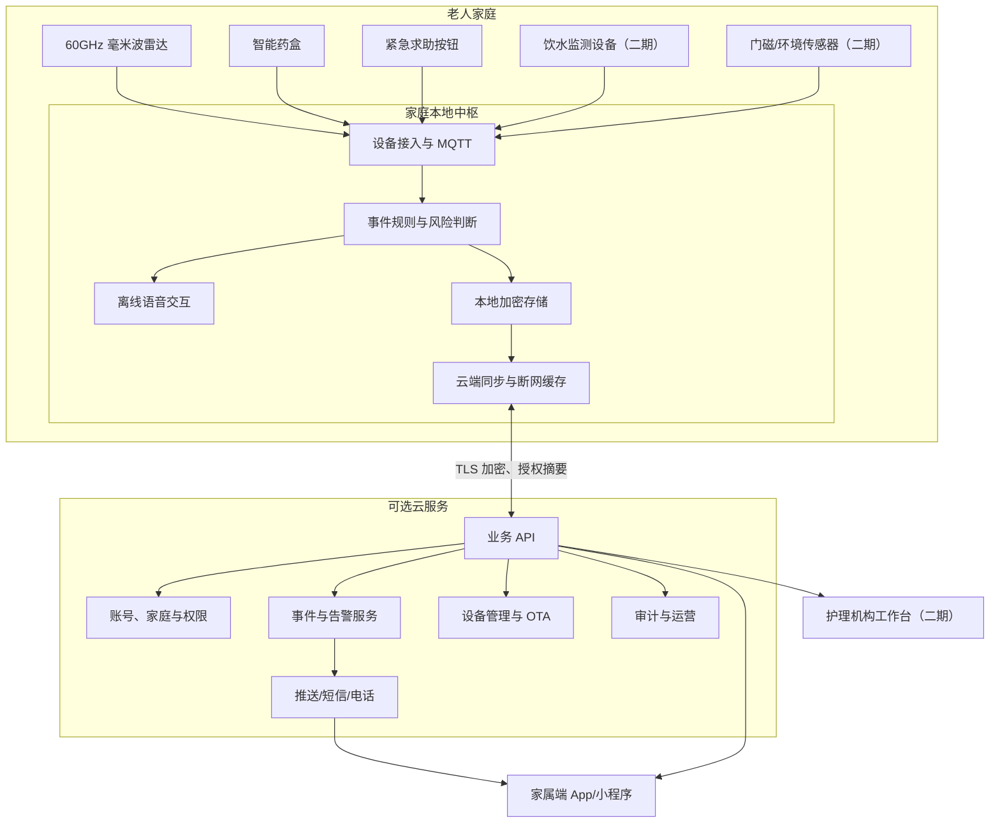
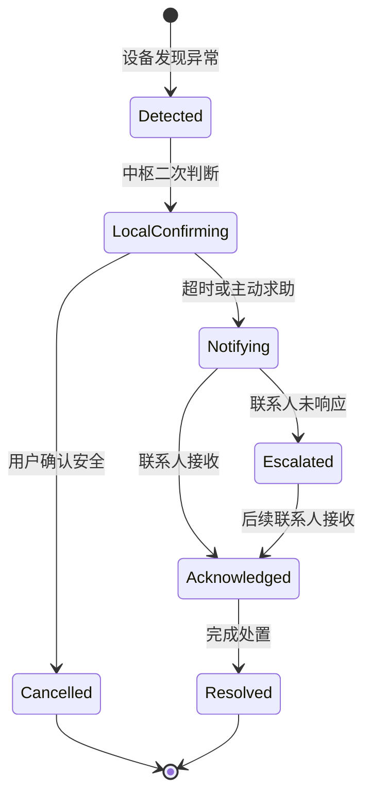

# VeniCare 类居家智能照护产品解决方案

> 文档版本：V1.0  
> 编制日期：2026-10-26  
> 文档状态：立项讨论稿

## 1. 项目概述

### 1.1 项目背景

随着独居、高龄及慢性病老人数量增加，家庭需要一种低打扰、易使用、断网可运行的居家照护系统，用于发现跌倒风险、辅助规律服药、记录饮水情况，并在必要时通知家属或护理人员。

本项目参考 VeniCare 的产品理念，建设一套由家庭本地中枢、毫米波雷达、智能药盒、饮水监测设备和家属端应用组成的居家智能照护系统。

系统采用“本地优先、云端可选”的架构：日常检测、提醒、语音交互和事件判断尽量在老人家中完成；云端主要承担账号关系、远程通知、设备运维和授权访问，避免持续上传敏感的家庭活动数据。

### 1.2 产品定位

产品定位为“居家生活照护辅助系统”，主要面向：

- 独居或白天独自在家的老人；
- 与老人异地居住的子女；
- 社区养老及居家护理机构；
- 适老化住宅、养老公寓和保险服务机构。

第一阶段不将产品定义为医疗诊断设备，也不承诺替代人工护理、专业医疗或法定紧急救援服务。

### 1.3 建设目标

1. 在不使用摄像头的情况下，识别疑似跌倒及长时间静止事件；
2. 通过语音、灯光和声音进行用药提醒，并记录用户确认；
3. 支持家属查看老人状态和接收分级告警；
4. 在互联网中断时继续完成本地检测、提醒和事件记录；
5. 建立可扩展的设备接入平台，后续支持饮水、门磁、燃气、睡眠及环境传感器；
6. 保护老人隐私，保证数据访问经过明确授权并可撤销。

## 2. 建设范围

### 2.1 一期 MVP 范围

一期优先完成风险最高、价值最明确的闭环：

- 家庭本地中枢；
- 单房间毫米波跌倒检测；
- 本地语音询问和确认；
- 一键求助按钮；
- 家属端 App 或小程序；
- App 推送、短信及电话告警；
- 设备管理、日志和远程升级；
- 基础智能药盒及服药提醒。

### 2.2 二期范围

- 多房间雷达协同；
- 杯垫式饮水监测；
- 门磁、人体存在及环境传感器；
- 日常活动规律和异常趋势识别；
- 护理机构工作台；
- 多老人、多护理人员和交接班管理。

### 2.3 暂不纳入一期

- 医疗诊断和疾病预测；
- 自动拨打法定急救电话；
- 摄像头视频监控；
- 开放式通用语音聊天；
- 根据监测结果自动调整处方；
- 仅凭药盒开盖动作断言老人已经服药。

## 3. 用户角色与核心场景

### 3.1 用户角色

| 角色 | 主要需求 |
| --- | --- |
| 老人 | 操作简单、提醒清晰、少打扰、隐私可控 |
| 家属 | 及时获知重大风险，不被大量误报告警干扰 |
| 护理人员 | 查看待处理事件、确认处置结果、完成交接 |
| 系统管理员 | 管理设备、版本、账号、服务状态和审计日志 |
| 售后人员 | 经授权后诊断设备故障，不接触非必要隐私数据 |

### 3.2 核心业务场景

#### 疑似跌倒

1. 雷达检测到快速下降、倒地姿态或异常静止；
2. 家庭中枢结合持续时间、位置和后续动作进行二次判断；
3. 中枢播放语音：“检测到您可能跌倒，您还好吗？”；
4. 老人通过语音、按钮或起身动作取消告警；
5. 在规定时间内无响应，通知第一联系人；
6. 第一联系人未确认时，按策略升级至其他联系人、短信或电话；
7. 系统记录检测、询问、通知、确认和处置全过程。

#### 服药提醒

1. 家属或授权人员录入服药计划；
2. 家庭中枢在指定时间发出语音、灯光或蜂鸣提醒；
3. 用户打开对应药仓，并通过按钮或语音确认；
4. 系统记录“已操作确认”“稍后提醒”或“未确认”；
5. 超时未确认时再次提醒，并按配置通知家属。

#### 主动求助

老人按下固定或随身求助按钮后，家庭中枢立即进行本地声光反馈，并向联系人发送高优先级告警。该流程不依赖跌倒算法。

## 4. 总体设计原则

1. **本地优先**：核心检测、规则、提醒、语音和缓存运行在家庭中枢；
2. **隐私优先**：默认不使用摄像头，不上传雷达原始点云；
3. **离线可用**：断网不影响本地照护功能，恢复后补传事件；
4. **分级告警**：疑似事件先本地确认，再按照严重程度逐级通知；
5. **故障可见**：设备离线、低电量和传感器异常必须主动提示；
6. **老人友好**：减少登录、触屏、复杂菜单和频繁充电；
7. **安全默认**：设备身份、加密通信、最小权限和签名升级从第一版开始建设；
8. **责任可追溯**：关键事件及处置过程留有不可随意修改的审计记录。

## 5. 总体系统架构



## 6. 硬件设计方案

### 6.1 家庭本地中枢

#### 功能

- 连接并管理家庭内传感器；
- 运行本地规则引擎和事件状态机；
- 完成离线语音唤醒、识别和播报；
- 保存事件、配置和审计记录；
- 在断网时缓存通知任务；
- 提供设备配网、健康检查和 OTA；
- 驱动扬声器、状态灯及本地物理按键。

#### 原型建议配置

| 项目 | 建议 |
| --- | --- |
| 处理器 | RK3588、Raspberry Pi 5 或同等级 ARM 平台 |
| 内存 | 4GB 起，建议 8GB |
| 存储 | 32GB 起，建议 64GB eMMC 或 SSD |
| 网络 | 千兆以太网、2.4/5GHz Wi-Fi、BLE |
| 音频 | 双麦克风或四麦克风阵列、3W 以上扬声器 |
| 本地交互 | 状态灯、静音键、求助/确认键 |
| 供电 | 稳定适配器，可选小型后备电池 |
| 安全 | TPM/安全芯片、唯一设备证书 |

原型阶段采用成熟计算板快速验证；完成真实家庭试点后，再设计量产主板、结构、散热、电源及生产测试工装。

### 6.2 毫米波雷达

#### 建议方案

- 频段：60GHz；
- 安装方式：墙装或顶装；
- 输出：人体存在、位置、速度、姿态、目标高度及置信度；
- 通信：优先有线供电，Wi-Fi、以太网或串口转网关；
- 原型选型：TI IWRL6432、Infineon BGT60 系列或带跌倒算法的成熟模组。

#### 算法策略

跌倒判断不能依赖单一阈值，应综合：

- 身体高度短时间快速下降；
- 下降前后的运动速度；
- 倒地姿态持续时间；
- 是否重新站起；
- 目标所在区域，例如床、沙发或地面；
- 用户对语音询问的响应；
- 其他传感器事件。

系统输出应为“疑似跌倒事件”和置信度，而不是直接宣称医学意义上的确定跌倒。

#### 安装要求

- 每个雷达在 App 中完成房间类型、安装高度和方向标定；
- 床、沙发、卫生间等区域需要配置空间标签；
- 金属遮挡、风扇、宠物和多人活动场景需要专项测试；
- 安装后必须执行走动、坐下、躺床、捡东西和模拟跌倒测试。

### 6.3 智能药盒

#### 硬件组成

- ESP32-C6 或同类低功耗 MCU；
- 开盖/霍尔传感器；
- LED、蜂鸣器及实体确认键；
- 可选电子墨水屏；
- USB-C 供电或可充电电池；
- 防呆药仓编号和大字号标识。

#### 状态定义

- 待提醒；
- 正在提醒；
- 药仓已打开；
- 用户已确认；
- 稍后提醒；
- 超时未确认；
- 设备离线或低电量。

药仓打开只能作为服药操作证据之一。产品界面及报告不得将其描述为确定服药。

### 6.4 紧急求助按钮

- 支持固定墙面按钮和随身按钮；
- 大尺寸、长按防误触或支持二次取消；
- 低电量主动上报；
- 通信优先选用低功耗协议；
- 按下后必须有声音、灯光或震动反馈；
- 家庭中枢离线时仍能触发本地告警。

### 6.5 饮水监测设备（二期）

建议先实现固定水杯配套的称重杯垫：

- 称重传感器和高精度 ADC；
- ESP32 低功耗控制器；
- 防水结构；
- LED 或电子墨水屏；
- 加速度或接触传感器作为辅助。

算法需区分饮水、加水、取放杯子、洒水和更换容器。第一版限定容器规格，可明显降低校准和识别难度。

## 7. 软件设计方案

### 7.1 家庭中枢软件

建议采用 Linux 容器化部署，各服务职责如下：

| 服务 | 职责 | 建议技术 |
| --- | --- | --- |
| 设备网关 | 设备注册、心跳、命令与遥测 | Mosquitto MQTT、Go |
| 事件引擎 | 规则、状态机、告警升级 | Go 或 Python |
| 本地 API | 配置、查询及本地管理 | FastAPI 或 Go |
| 本地数据库 | 配置、事件、审计、缓存 | SQLite |
| 语音服务 | 唤醒、识别、意图及播报 | openWakeWord、sherpa-onnx/whisper.cpp、Piper |
| 同步服务 | 云端同步、重试、去重 | Go |
| 设备管理 | 健康检查、版本、OTA | 自研轻量服务 |

家庭场景数据量有限，一期无需引入复杂的大数据平台。SQLite 配合定期备份、加密和日志归档即可满足单家庭中枢需求。

### 7.2 语音交互

一期采用受限意图模型，支持：

- “我没事”；
- “帮我叫家人”；
- “我已经吃药了”；
- “十分钟后再提醒”；
- “今天还要吃什么药”；
- “现在几点”；
- “停止提醒”。

语音识别失败时必须允许使用实体按键。涉及告警取消的命令应进行关键词、说话距离和连续状态校验，降低电视声音造成误取消的风险。

### 7.3 云端服务

云端按模块拆分，但一期可采用模块化单体，避免过早微服务化。

主要模块：

- 用户、家庭和联系人管理；
- 设备注册与证书管理；
- 事件接收和告警编排；
- App 推送、短信及电话服务；
- 配置同步；
- OTA 版本与灰度发布；
- 售后诊断；
- 审计日志；
- 运营统计。

部署可采用国内公有云的托管数据库、对象存储、消息队列和容器服务。生产环境至少划分开发、测试和生产三套环境。

### 7.4 家属端

建议使用 Flutter 开发 iOS/Android App；若需快速试点，可以先建设响应式 Web 或微信小程序。

核心功能：

- 老人当前状态及最后活动时间；
- 重要事件时间线；
- 告警接收、确认和处置备注；
- 服药计划与确认记录；
- 设备在线、低电量和故障状态；
- 联系人及告警升级顺序；
- 数据共享与权限管理；
- 安装标定和远程协助。

首页不展示大量传感器原始数据，应优先回答“是否安全”“是否存在待处理事件”“设备是否正常”。

### 7.5 护理机构工作台（二期）

- 多老人列表；
- 按严重程度排序的待处理事件；
- 值班和交接班；
- 处置时效统计；
- 设备批量管理；
- 机构、楼栋、房间及护理人员权限隔离。

## 8. 设备通信与数据设计

### 8.1 通信协议

- 家庭内消息总线：MQTT；
- 云端接口：HTTPS REST；
- 实时事件：MQTT over TLS 或 WebSocket；
- 设备首次配网：BLE；
- 低功耗传感器：BLE、Thread 或 Zigbee，量产前统一一种主要协议；
- 所有外网连接使用 TLS。

MQTT 主题示例：

```text
home/{homeId}/device/{deviceId}/telemetry
home/{homeId}/device/{deviceId}/event
home/{homeId}/device/{deviceId}/state
home/{homeId}/device/{deviceId}/command
home/{homeId}/hub/{hubId}/health
```

### 8.2 核心事件模型

```json
{
  "eventId": "uuid",
  "homeId": "home-id",
  "deviceId": "radar-bedroom-01",
  "type": "POSSIBLE_FALL",
  "severity": "HIGH",
  "confidence": 0.87,
  "occurredAt": "2026-10-26T07:30:00Z",
  "status": "LOCAL_CONFIRMING",
  "evidence": {
    "rapidHeightDrop": true,
    "lyingDurationSeconds": 18,
    "zone": "floor"
  }
}
```

事件必须带全局唯一 ID。家庭中枢和云端均按照事件 ID 去重，避免断网重传产生重复告警。

### 8.3 事件状态机



## 9. 告警与容错设计

### 9.1 告警等级

| 等级 | 示例 | 默认处理 |
| --- | --- | --- |
| 提示 | 正常用药提醒 | 本地语音/灯光 |
| 一般 | 药物未确认、设备低电量 | App 通知 |
| 重要 | 长时间无活动、设备持续离线 | App 推送并要求确认 |
| 紧急 | 疑似跌倒、主动求助 | 本地确认后推送、短信、电话升级 |

### 9.2 容错要求

- 互联网中断：本地功能正常，事件持久化，恢复后补传；
- 云端故障：中枢继续检测与提醒；
- 雷达离线：主动通知并显示该区域暂时无法检测；
- 中枢断电：恢复后自动启动服务并检查未完成事件；
- App 推送失败：紧急告警自动升级短信或电话；
- 重复事件：利用事件 ID 和时间窗口合并；
- 时间异常：中枢配置 RTC，并通过可信时间源校时。

## 10. 安全与隐私设计

### 10.1 设备安全

- 每台设备具有唯一身份和证书；
- 设备与中枢、云端之间使用双向 TLS；
- 启用安全启动及固件签名校验；
- OTA 支持灰度、失败回滚和版本冻结；
- 禁止使用统一默认密码；
- 调试端口在量产版本关闭或受控开放；
- 安全密钥存储在安全芯片或可信执行环境中。

### 10.2 数据安全

- 本地敏感数据加密存储；
- 云端只保存实现业务所必需的数据；
- 雷达原始点云默认不离开家庭；
- 权限按照老人、家属、护理人员、售后和管理员隔离；
- 远程访问需要老人或法定授权人同意；
- 授权可随时撤销；
- 关键查看、配置修改和事件处置写入审计日志；
- 提供数据导出、删除和保留期限配置。

### 10.3 隐私原则

1. 默认最少采集；
2. 默认关闭非必要远程共享；
3. 明确说明每类数据的用途；
4. 不将照护数据用于广告画像；
5. 算法训练数据需单独授权和脱敏；
6. 售后远程诊断默认看不到老人日常活动详情。

## 11. 合规与责任边界

本方案暂按中国市场、非医疗级照护辅助产品进行规划。正式销售前应由专业法规人员确认：

- 《个人信息保护法》；
- 《数据安全法》；
- 《网络安全法》；
- App 和小程序隐私合规要求；
- 无线电发射设备型号核准；
- CCC、SRRC、RoHS 等适用认证；
- 电池运输及安全认证；
- 产品是否因宣传、用途或算法功能进入医疗器械监管范围。

产品材料应明确：

- 系统可能产生误报或漏报；
- 系统不能替代护理人员、医生或急救服务；
- 药盒确认不等于药物实际服用；
- 用户需要配置有效联系人及备用通知渠道；
- 设备离线或断电期间部分能力可能不可用。

若目标市场为欧盟或美国，需要重新评估 GDPR、RED、CE、FCC、HIPAA 适用性及医疗器械分类。

## 12. 实施计划

### 12.1 阶段一：技术验证，6～8 周

目标：验证“检测—确认—通知—处置”完整链路。

交付内容：

- 开发板家庭中枢；
- 一款现成毫米波雷达模组；
- 本地 MQTT、数据库和事件引擎；
- 基础离线语音询问；
- 简易家属端 Web；
- App/短信告警；
- 实验室场景测试报告。

退出标准：

- 断网时仍可完成本地检测与语音确认；
- 网络恢复后事件可补传且不重复告警；
- 主动求助端到端通知成功；
- 能记录完整事件状态和操作日志。

### 12.2 阶段二：MVP，10～14 周

交付内容：

- 完整家属端 App 或小程序；
- 智能药盒原型；
- 设备配网和安装标定；
- 联系人告警升级；
- 设备健康监测；
- 签名 OTA；
- 5～10 户内部或友好用户试点。

### 12.3 阶段三：真实家庭试点，3～4 个月

规模：10～30 户。

重点验证：

- 每户每天误报次数；
- 模拟跌倒及真实风险事件的检出情况；
- 告警从发生到送达的时延；
- 老人对语音询问的响应率；
- 断网、断电和设备离线恢复；
- 药盒提醒完成率；
- 安装和售后成本；
- 老人与家属的使用接受度。

### 12.4 阶段四：量产准备，6～12 个月

- 定制 PCB 和工业设计；
- DFM、可靠性和环境测试；
- 认证与合规审查；
- 生产测试工装；
- 序列号、证书烧录和供应链追溯；
- 批量 OTA 和客服体系；
- 100 户以上规模试点；
- 商业化定价和渠道验证。

## 13. 团队配置建议

MVP 阶段建议 7～10 人：

| 角色 | 人数 | 职责 |
| --- | ---: | --- |
| 产品经理 | 1 | 用户研究、需求及试点 |
| 嵌入式工程师 | 1～2 | 雷达、药盒、通信和 OTA |
| 边缘端工程师 | 1～2 | 中枢、规则、语音和设备管理 |
| 后端工程师 | 1～2 | 云端业务、告警和运维 |
| App/前端工程师 | 1～2 | 家属端和管理端 |
| 测试工程师 | 1 | 系统、场景及可靠性测试 |
| 算法工程师 | 1 | 雷达算法、阈值及数据评估 |
| 硬件/结构顾问 | 兼职或外包 | 原理图、PCB、结构及认证 |

还需在试点阶段引入养老护理顾问、法规顾问和真实用户研究人员。

## 14. 成本初步估算

以下仅用于立项测算，不作为采购报价。

### 14.1 原型硬件单套

| 项目 | 估算范围 |
| --- | ---: |
| 家庭中枢开发板及存储 | ¥800～2,000 |
| 麦克风、扬声器及电源 | ¥200～600 |
| 毫米波雷达模组 | ¥300～1,500 |
| 药盒电子原型 | ¥200～600 |
| 求助按钮及辅助传感器 | ¥100～300 |
| 外壳、线材和加工 | ¥300～1,000 |
| 合计 | 约 ¥1,900～6,000 |

### 14.2 研发投入

一个 7～10 人团队完成技术验证和 MVP，通常需要 4～6 个月。实际预算受人员地区、是否自研雷达算法、App 形态和硬件定制程度影响，应单独制作人力及供应链预算表。

量产成本目标应在完成雷达选型、结构方案和试点后确定。过早承诺整机成本容易忽略认证、售后、安装和通信服务费用。

## 15. 测试与验收指标

### 15.1 功能指标

- 主动求助事件通知成功率不低于 99.9%；
- 互联网中断时核心本地功能可运行；
- 网络恢复后事件补传完整且不重复；
- 设备低电量、离线和故障可以被发现；
- 紧急告警支持至少两种独立通知渠道；
- 关键配置、告警和处置均有审计记录。

### 15.2 性能指标

- 本地事件进入规则引擎延迟小于 1 秒；
- 疑似跌倒触发本地询问时间小于 3 秒；
- 正常网络下云端收到紧急事件时间小于 5 秒；
- 家庭中枢异常重启后 2 分钟内恢复核心服务；
- 连续运行 30 天无人工重启。

### 15.3 算法指标

跌倒算法不能只用单一“准确率”评价，应分别统计：

- 灵敏度/召回率；
- 特异度；
- 每户每天误报次数；
- 不同房间和安装位置表现；
- 老人、宠物和多人场景表现；
- 从检测到联系人确认的实际闭环成功率。

算法指标应通过预定义动作测试和真实家庭试点共同评估。正式目标值需要根据试点基线确定。

### 15.4 安全指标

- 设备身份不可伪造；
- 未授权账号无法访问其他家庭；
- OTA 包被修改后无法安装；
- 敏感数据传输全程加密；
- 权限撤销后远程访问立即失效；
- 通过基础渗透测试和依赖漏洞扫描。

## 16. 主要风险与应对措施

| 风险 | 影响 | 应对措施 |
| --- | --- | --- |
| 跌倒误报过多 | 家属关闭通知、失去信任 | 分级确认、空间标定、真实家庭数据调优 |
| 跌倒漏报 | 安全与责任风险 | 主动按钮、多传感器辅助、明确产品边界 |
| 老人不会操作 | 产品无法持续使用 | 实体按键、自动运行、上门安装和语音引导 |
| 网络或电源不稳定 | 告警无法送达 | 本地运行、断网缓存、备用通知及后备电源 |
| 设备充电频繁 | 使用中断 | 固定设备有线供电，低功耗设备主动报电量 |
| 宣传触及医疗器械 | 上市和法律风险 | 早期法规评估，限制医疗性表述 |
| 多类硬件并行开发 | 周期和供应链失控 | 先中枢与雷达，再药盒，最后饮水 |
| 告警无人处置 | 闭环失效 | 多联系人升级、机构服务及处置超时机制 |
| 隐私泄露 | 法律及品牌风险 | 本地优先、最小采集、强认证和审计 |

## 17. 建议的产品推进顺序

1. 家庭中枢、主动求助和完整告警链路；
2. 单房间毫米波雷达及本地语音确认；
3. 家属端 App 和设备运维能力；
4. 智能药盒；
5. 多房间覆盖及异常活动识别；
6. 饮水监测；
7. 护理机构工作台及规模化运营。

该顺序优先解决“事件发生后能否可靠通知并得到处置”，再增加更多传感器，避免产品只有检测能力而没有服务闭环。

## 18. 待确认事项

立项前需要业务方确认：

1. 首发国家和地区；
2. 首要客户是家庭消费者、养老机构还是地产/保险客户；
3. 产品是否计划申报医疗器械；
4. 首期预算和期望上市时间；
5. 是否提供安装及 7×24 小时人工响应服务；
6. 家属端采用独立 App、微信小程序还是两者并行；
7. 是否要求完全离线，或允许使用云端语音和算法；
8. 预期零售价、订阅费和硬件毛利目标；
9. 首批试点家庭来源和数量；
10. 是否已有毫米波雷达、硬件制造或养老服务合作方。

## 19. 结论

本项目具备明确的社会价值和产品需求，但难点不在于简单连接几个智能设备，而在于跌倒识别可靠性、老人交互体验、告警处置闭环、隐私安全和长期运维。

建议先以“家庭中枢 + 主动求助 + 单房间雷达 + 家属告警”为 MVP，使用成熟开发板和雷达模组在 6～8 周内验证端到端链路。在真实家庭数据和运营流程得到验证前，不宜同时投入全部硬件的量产开发，也不宜对外承诺医疗级准确率或紧急救援能力。
