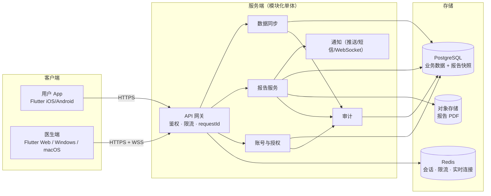
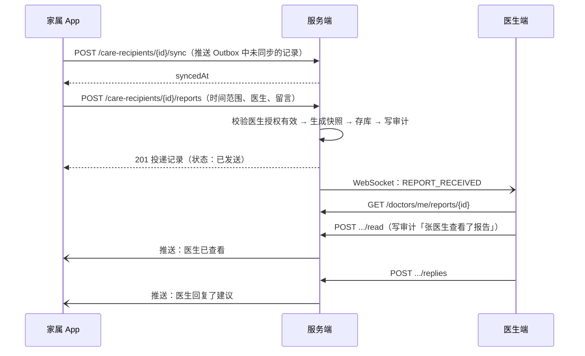
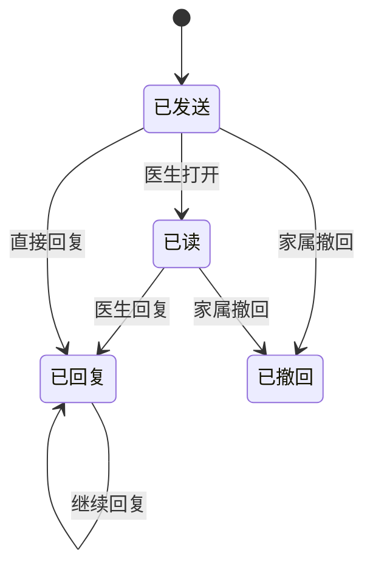

# 安心守护：医生端与服务端方案设计

> 范围：在现有用户 App（子女模式 + 老人模式）之外，新增 PC 医生端和服务端，使 App 中的健康数据可以生成完整报告并发送给医生；家属可按科室预约咨询；超管可查看医生空闲、排队与排班。所有业务数据由服务端存储。
>
> 相关文档：[解决方案](./VeniCare类似居家照护产品解决方案.md)、[App 端技术详细设计](./App端技术详细设计.md)。

## 1. 目标

1. 家属或老人在 App 中选择时间范围和医生，一键生成报告并发送；
2. 医生在 PC 上集中查看收到的报告，看得到趋势、异常和每一条原始记录，并能回复建议；
3. 家属可按科室浏览医生，查看空闲/排队，预约图文、电话或视频咨询；
4. 超管在医生工作台查看全院医生实时状态、排队与周排班负荷；
5. 服务端是健康数据、报告、排班与预约的唯一可信来源，App 本地只做缓存和离线暂存；
6. 健康数据属于敏感个人信息，授权、访问和导出全程可追溯。

一期不做：开处方/复诊病历、音视频通话 SDK 对接、医生主动调取未发送的数据、与医院 HIS/EMR 对接。排班由机构在系统内维护，暂不对接医院排班系统。

## 2. 角色

| 角色 | 使用端 | 能做什么 |
| --- | --- | --- |
| 老人（照护对象） | App 老人模式 | 记录血压/心率/血糖/用药；可一键发送报告（二期） |
| 家属 | App 子女模式 | 绑定医生、生成并发送报告、按科室预约咨询、查看医生回复、撤回报告 |
| 医生 | PC 医生端 | 切换在线/暂离/下线、查看收到的报告、标记已读、回复 |
| 超管 / 机构管理员 | PC 医生端「排班与接诊」 | 实时看板（空闲/接诊/排队）、周排班负荷、管理本机构医生账号 |
| 平台运营 | 运营后台 | 审核医生资质、处理投诉、查看审计 |

## 3. 总体架构



服务端沿用《解决方案》7.3 节「一期模块化单体」的原则：一个进程、按模块分包，等报告量或团队规模上来再拆。

## 4. 项目目录

```text
venicare/
├── apps/
│   ├── mobile/                 # 用户 App（原仓库根目录的 Flutter 工程整体迁入）
│   │   ├── lib/ test/ android/ ios/ web/
│   │   └── pubspec.yaml        # 包名仍为 venicare_app，import 不变
│   └── doctor_pc/              # 医生端，Flutter Web + Windows + macOS
│       ├── lib/src/api/        # 调用服务端的 HTTP 客户端
│       ├── lib/src/state/      # Riverpod 状态
│       ├── lib/src/ui/         # 工作台、报告详情、血压趋势图
│       └── web/ windows/ macos/
├── server/                     # 服务端（Dart + shelf）
│   ├── bin/server.dart         # 启动入口
│   ├── lib/src/api.dart        # 路由与接口
│   ├── lib/src/care_store.dart # 存储接口 + 内存实现
│   ├── lib/src/demo_seed.dart  # 开发用演示数据
│   └── db/migrations/          # PostgreSQL 表结构
├── packages/
│   └── venicare_shared/        # 三端共享：报告数据结构、参考线、报告生成逻辑（纯 Dart）
└── docs/                       # 方案与设计文档
```

各工程独立 `pubspec.yaml`，通过 `path:` 依赖 `packages/venicare_shared`。没有使用 pub workspace，原因是 workspace 会把 Flutter 依赖带进服务端的依赖解析，服务端镜像构建就得装 Flutter SDK。

`venicare_shared` 必须保持纯 Dart（不能 import Flutter），否则服务端无法使用。

## 5. 技术选型

| 部分 | 选型 | 理由 |
| --- | --- | --- |
| 医生端 | Flutter，一期以 Web 形态交付，同时可打 Windows/macOS 安装包 | 与 App 同语言同组件，团队只有 Flutter 经验也能做；医院电脑装软件审批慢，浏览器打开即可用 |
| 服务端 | Dart + shelf，模块化单体 | 与两端共享报告结构和生成逻辑（同一份代码、同一套测试），小团队不用维护两种语言的模型 |
| 数据库 | PostgreSQL 16 | 事务、约束、JSONB 存报告快照、部分索引；国内云均有托管版 |
| 文件 | 对象存储（阿里云 OSS / 腾讯云 COS，私有部署用 MinIO） | 存报告 PDF；只通过短时效签名 URL 下载 |
| 缓存 | Redis | 会话、验证码限流、WebSocket 多实例广播 |
| 实时通知 | WebSocket（医生端）+ 推送/短信（App） | 新报告到达时医生端即时刷新；医生回复推送给家属 |

**关于服务端语言的取舍**：Dart 服务端生态比 Java/Go 小，ORM、监控等需要自己搭得更多。如果后续服务端交给熟悉 Java（Spring Boot）或 Go 的同事，可以替换：接口约定（第 8 节）和表结构（`server/db/migrations`）不依赖语言，只需在新语言里重写 `venicare_shared` 中的报告生成逻辑，并用同一组测试数据比对结果。

**医生端 Windows 兼容性**：Flutter Windows 桌面要求 Windows 10 及以上。不少医院电脑仍是 Windows 7，这类电脑用 Web 版（需安装 Chromium 内核浏览器），这也是一期以 Web 为主的原因。

## 6. 报告设计

### 6.1 报告内容

报告的数据结构定义在 `packages/venicare_shared/lib/src/report/report_models.dart`（`HealthReport`）。

| 部分 | 内容 |
| --- | --- |
| 基本信息 | 姓名、性别、年龄、家属填写的病史和在用药（标注「未经核实」） |
| 报告范围 | 起止日期、有测量记录的天数 / 总天数（数据完整度） |
| 指标汇总 | 血压、心率、血糖的次数、平均、最低、最高、超参考线次数 |
| 血压趋势 | 按真实时间绘制收缩压/舒张压折线，叠加 140/90 参考线 |
| 全部原始记录 | 每一条测量：时间、数值、来源（语音/手输/设备）、老人原话 |
| 用药 | 计划次数、已确认次数、未确认明细、确认方式 |
| 照护事件 | 跌倒、长时间未活动等事件及处置结果 |
| 家属留言 | 发送时填写，例如「最近早上头晕」 |

「完整」的含义：原始记录全部附上，而不只是汇总，医生可以自己判断。老人的语音原话一并保留，语音识别出错时医生能看出来。

两条表述约束（与《解决方案》第 11 节一致）：

- 超参考线只写「高于 140/90」，不写「高血压」「异常」等诊断性词语；
- 药仓打开不等于服药，报告中单独标出「药仓已打开（不代表已服药）」。

### 6.2 由服务端生成，生成后不可修改

报告由服务端根据已同步的数据生成，App 只发起请求。原因：

- 数据以服务端为准，App 本地可能缺数据（换手机、多个家属分别记录）；
- 报告生成后存为 JSON 快照（`health_reports.snapshot`）并记录 SHA-256。之后老人撤销或修改某条记录，已发出的报告不变。医生看到的内容可追溯，出现纠纷时能还原当时的报告；
- 内容需要更正时，重新生成一份新报告，旧报告可撤回。

生成逻辑 `buildHealthReport` 放在共享包中，App 将来可以用它做本地「报告预览」，结果与服务端一致。

报告快照带 `schemaVersion`。医生端遇到比自己新的版本会提示升级，不会把数据显示错。

### 6.3 发送流程



App 端发送前必须先完成同步，否则报告会缺少刚记录的数据。离线时「发送报告」按钮置灰，并说明原因。

### 6.4 投递状态

同一份报告可以发给多位医生，每位医生一条「投递」（`report_deliveries`），状态各自独立：



撤回后医生端不再显示该报告，但审计记录保留。已回复的报告不能撤回，避免医生给出的建议失去上下文。

### 6.5 医生绑定与授权

报告只能发给已授权的医生，防止误发给陌生人：

1. 医生在医生端「我的二维码」中展示带签名、有效期 10 分钟的二维码；
2. 家属在 App 扫码，看到医生姓名、机构、科室和授权说明；
3. 家属勾选《健康数据共享授权》（单独同意，记录协议版本）后确认，生成 `doctor_authorizations` 记录；
4. 家属可随时在「数据共享」中解除授权。解除后不能再发新报告，已发出的报告仍保留在医生端（可另行撤回）。

医生账号必须经过资质审核（执业证 + 所在机构证明）才能被扫码绑定。

## 7. 医生端功能

一期（当前骨架已实现标 ✅）：

- ✅ 收件箱：按发送时间倒序，未读/已读/已回复筛选，标出超参考线读数条数和紧急事件次数；
- ✅ 报告详情：基本信息、家属留言、指标汇总卡、血压趋势图、全部记录表（超参考线行高亮）、用药、事件；
- ✅ 打开即标记已读；
- ✅ 回复家属；
- 登录（手机验证码 + 机构内账号密码二选一，Web 端会话 12 小时）；
- 新报告实时提醒（WebSocket + 浏览器通知）；
- 打印 / 导出 PDF（带医生姓名和时间水印）；
- 我的二维码（供家属绑定）；
- 按患者查看历史报告。

二期：同一患者多份报告对比、回复模板、排班编辑 UI、音视频通话、与医院系统对接。

## 7A. 咨询预约与超管看板

### 7A.1 医生状态

医生自己设置的在线状态（`DoctorPresence`）：`online` / `away` / `offline`。

服务端据此再叠加排班与预约，算出家属可见的接诊状态（`DoctorStatus`）：

| 状态 | 含义 | 家属是否可约当前号 |
| --- | --- | --- |
| 空闲 | 在线且在班，当前无人接诊 | 可 |
| 接诊中 | 在线且正在看诊 | 可约后续号，显示排队人数 |
| 暂离 | 医生标记暂时离开 | 可约后续号，不可立即呼叫 |
| 不在班 | 当前无排班 | 仅能约今后有排班的时段 |
| 离线 | 医生下线 | 同上 |

### 7A.2 排班与号源

- 排班按「班次」存：起止时间、每格分钟数、每格可约人数、支持的咨询方式（图文/电话/视频）；
- 号源由班次切成时段（slot），家属选具体时段预约；
- 同一患者同一天对同一医生只能有一个活跃预约；号源满返回 `SLOT_FULL`。

### 7A.3 排队规则

预约到点后进入该医生队列；队列按「时段开始时间 → 预约时间」排序。家属端可看「前面还有几人」（含正在接诊的 1 人）。医生开始接诊后预约不可取消。

### 7A.4 超管看板（医生端）

`isAdmin` 医生可见「排班与接诊」页，含：

1. **实时看板**：在线人数、空闲可咨询、接诊中、排队总数、今日预约/号源；按科室筛选；每位医生卡片显示状态、正在接诊、排队名单、今日稍后预约、今日班次负荷条；
2. **排班表**：按周查看医生 × 日的班次与已约/容量，颜色标宽松 / 较满 / 将满。

看板每 30 秒自动刷新（后续接 WebSocket）。

### 7A.5 家属 App

首页快捷入口「预约医生」、我的 →「咨询预约」：按科室筛选 → 医生卡片（状态、排队、最早可约）→ 选方式与时段 → 我的预约（排队位置、取消）。

当前 App 使用本地 `DemoConsultRepository` 演示；接入服务端后改为调用下方咨询接口。

## 8. 服务端

### 8.1 模块

| 模块 | 职责 |
| --- | --- |
| 账号与授权 | 家属/医生登录、家庭成员、医生资质、医生授权、同意记录 |
| 数据同步 | 接收 App 上传的测量、用药、事件，按 ID 幂等写入 |
| 报告 | 生成快照、投递、状态流转、回复、PDF 生成 |
| 咨询与排班 | 科室、班次、号源、预约、医生在线状态、超管看板 |
| 通知 | WebSocket 推送医生端；个推/短信推送家属 |
| 审计 | 所有对健康数据的读写和导出，只追加不修改 |

### 8.2 接口

沿用《App 端技术详细设计》第 8 节的约定：`/api/v1`、ISO 8601 UTC、统一错误格式 `{"error": {"code", "message", "requestId"}}`。

当前骨架已实现：

```text
GET  /healthz

POST /api/v1/care-recipients/{rid}/sync           # 批量上传测量/用药/事件，按 id 幂等
GET  /api/v1/care-recipients/{rid}/doctors        # 已授权的医生
POST /api/v1/care-recipients/{rid}/reports        # 生成并发送报告
GET  /api/v1/care-recipients/{rid}/reports        # 家属查看已发送报告和医生回复

GET  /api/v1/doctors/{did}                        # 医生资料
GET  /api/v1/doctors/{did}/reports?status=        # 收件箱
GET  /api/v1/doctors/{did}/reports/{id}           # 报告详情
POST /api/v1/doctors/{did}/reports/{id}/read      # 标记已读
POST /api/v1/doctors/{did}/reports/{id}/replies   # 回复

GET  /api/v1/departments
GET  /api/v1/consult/doctors?departmentId=        # 家属端医生卡片（含状态与排队）
GET  /api/v1/consult/doctors/{did}/slots?from=&days=
GET  /api/v1/care-recipients/{rid}/appointments
POST /api/v1/care-recipients/{rid}/appointments
POST /api/v1/care-recipients/{rid}/appointments/{id}/cancel
GET  /api/v1/doctors/{did}/presence
PUT  /api/v1/doctors/{did}/presence
GET  /api/v1/doctors/{did}/admin/board            # 超管实时看板
GET  /api/v1/doctors/{did}/admin/schedule?from=&days=
```

**注意**：骨架中医生和照护对象 ID 直接取自 URL，任何人都能冒充，仅供本地开发。接入登录后，医生接口改为 `/api/v1/doctors/me/...`，身份从 Token 中取。

待实现：

```text
POST   /api/v1/doctor-auth/sms/request | verify   # 医生登录
POST   /api/v1/doctors/me/binding-codes           # 生成绑定二维码
POST   /api/v1/care-recipients/{rid}/doctor-authorizations       # 扫码授权
DELETE /api/v1/care-recipients/{rid}/doctor-authorizations/{id}  # 解除授权
POST   /api/v1/care-recipients/{rid}/reports/{id}/revoke         # 撤回
GET    /api/v1/doctors/me/reports/{id}/pdf        # 返回 5 分钟有效的签名下载地址
POST   /api/v1/admin/shifts                       # 超管编排班次
POST   /api/v1/doctors/me/appointments/{id}/start|complete
WSS    /api/v1/realtime                           # REPORT_RECEIVED、APPOINTMENT_QUEUED
```

### 8.3 数据存储

表结构见 `server/db/migrations/0001_init.sql` 与 `0002_consult.sql`：

- 账号与家庭：`users`、`families`、`family_members`、`care_recipients`
- 医生与授权：`organizations`、`doctors`、`doctor_authorizations`、`consents`
- 咨询排班：`departments`、`doctor_shifts`、`consult_appointments`（医生 `presence` / `is_admin` / `department_id`）
- 健康数据：`vital_readings`、`medication_plans`、`medication_doses`、`care_events`
- 报告：`health_reports`（快照）、`report_deliveries`（投递）、`report_replies`
- 审计：`audit_logs`

要点：

- 测量记录的 ID 由 App 生成。App 的 Outbox 重试时重复上传同一条记录，服务端按 ID 覆盖，不会产生重复数据；
- 老人撤销记录只做软删除（`deleted_at`），不影响已生成的报告；
- 手机号、执业证号等只存密文和 HMAC 摘要，密钥放在云 KMS；
- 数据库开启存储加密和每日备份，备份保留 30 天，至少每季度做一次恢复演练；
- 服务端骨架目前使用内存存储（`InMemoryCareStore`，重启即丢失），下一步按同一个 `CareStore` 接口实现 PostgreSQL 版本。

### 8.4 App 端需要的改造

1. 把 `DemoRepository` / `DemoConsultRepository` 替换为远程 Repository，新记录先进本地 Outbox，再调用 `/sync`；
2. 「健康记录」页增加「生成报告发给医生」：选择时间范围（默认近 30 天）、选择医生、填写留言，发送前展示报告预览（用 `buildHealthReport` 在本地生成）；
3. 「数据共享」页增加医生授权管理和扫码绑定；
4. 「访问记录」页从服务端审计日志读取，显示「张医生查看了 11 月的健康报告」这类记录；
5. 咨询预约页改为调用 `/api/v1/consult/*`，与超管看板共用同一套状态计算；
6. App 内的 `HealthRecord` 与共享包的 `VitalReading` 之间加一层转换。

## 9. 安全与合规

健康数据属于《个人信息保护法》第 28 条规定的敏感个人信息，以下是硬性要求：

| 要求 | 做法 |
| --- | --- |
| 单独同意 | 绑定医生时单独弹出授权说明并勾选，记录协议版本；老人本人有表达能力时应由本人或其监护人同意 |
| 最小必要 | 医生只能看到发给他的报告，不能浏览患者的全部数据 |
| 可撤回 | 家属可解除授权、撤回未回复的报告 |
| 境内存储 | 服务器和备份都在境内 |
| 访问留痕 | 医生的每次查看、打印、导出都写审计，并在家属端「访问记录」中可见 |
| 传输与存储加密 | 全站 HTTPS（TLS 1.2+），数据库与对象存储加密，敏感字段应用层加密 |
| 防越权 | 所有接口在服务端校验「当前医生是否为该投递的接收人」，越权一律返回 404，避免通过 ID 探测数据是否存在 |
| 等级保护 | 上线前按网络安全等级保护第三级准备（含健康数据的系统通常定为三级） |

**医疗责任边界**：医生端的「回复」与咨询预约定位为健康建议，界面和协议中注明「不构成诊断和处方」。音视频接诊、复诊病历、开处方需依托有资质的互联网医院，不在本方案一期范围内。

## 10. 部署与环境

- 环境：开发、测试、生产三套，数据库和对象存储各自独立，测试环境不使用真实用户数据；
- 服务端打包为容器镜像，部署在国内云容器服务，至少两个实例，前面接负载均衡；
- 医生端 Web 版作为静态文件部署在 CDN / 对象存储上，与 API 使用不同域名，服务端只允许医生端域名跨域（骨架中跨域是全放开的，仅供开发）；
- 医生端 Windows/macOS 安装包按需提供，内置 API 地址，支持自动更新检查。

## 11. 实施计划

| 阶段 | 周期 | 内容 |
| --- | --- | --- |
| 0：骨架（已完成） | — | 目录调整、报告 + 咨询共享模型、服务端内存版、医生端报告/超管看板、App 咨询预约演示 |
| 1：持久化与登录 | 3 周 | PostgreSQL（含排班预约表）、医生/家属登录、Token 鉴权、审计写入 |
| 2：App 打通 | 3 周 | 远程 Repository + Outbox、发送报告、咨询接口替换本地演示、扫码绑定 |
| 3：医生端完善 | 2～3 周 | 排班编辑、接诊开始/结束、实时提醒、PDF、二维码 |
| 4：合规与试点 | 2～3 周 | 资质审核、授权协议、安全测试、等保准备、试点机构上线 |

按 1 名后端、2 名 Flutter 估算，约 10～11 周可以进入试点。

## 12. 待确认事项

1. 服务端语言：继续用 Dart，还是由后端同事用 Java/Go 实现（接口和表结构可以不变）；
2. 首批合作医生来自哪里（社区卫生服务中心 / 医院 / 签约家庭医生），决定医生资质审核和机构管理的复杂度；
3. 医院电脑环境：是否能装 Chrome，是否有内网限制访问公网；
4. 老人模式是否也允许直接发送报告，还是只能由家属发送；
5. 血压参考线：目前沿用 App 中的 140/90。《中国高血压防治指南》中家庭自测血压的参考值是 135/85，是否改用需与合作医生确认；
6. 报告默认时间范围（7 天 / 30 天 / 自定义）以及单份报告的最大跨度；
7. 是否需要医生回复后家属能继续追问（会变成对话，涉及在线问诊资质）；
8. 咨询是否必须先绑定医生（当前演示：可直接按科室预约；报告发送仍要求授权）；
9. 号源默认时长与每格容量（当前演示：30 分钟 / 每格 2～4 人）。
